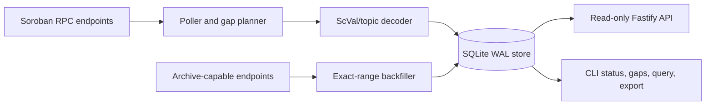

# Architecture

The indexer treats event IDs as the durable deduplication key. A page's events, checkpoint, and interval coverage are committed together. Coverage intervals are merged when adjacent or overlapping, while gaps remain explicit records until a complete range is recovered.
